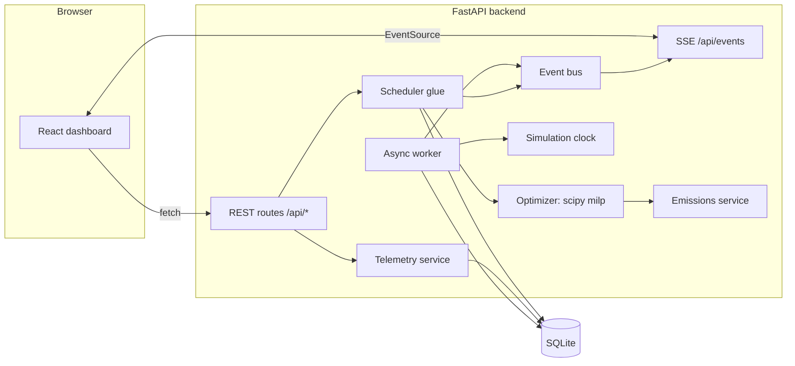

# AI-Driven Smart Energy Load Optimizer for Cloud Infrastructure
**SDG 13 — Climate Action · carbon-aware job scheduler prototype**

> **Read this first.** Carbon intensity is **manually configured by an administrator** (no live grid API). All jobs and
> energy figures are **simulated**. The app does **not** measure real emissions or reduce real electricity use — it
> *estimates the potential difference between two execution schedules* under the configured assumptions.

## 1. Problem and motivation
Data-center electricity has a carbon footprint that depends on *when* it is drawn: the same 2 kWh job emits far more on a
coal-heavy grid hour than on a solar-heavy one. Many workloads (training, ETL, backups, renders) are flexible. A
scheduler that shifts them into cleaner windows — without breaking deadlines or capacity — can lower the emissions
*associated* with the work. This supports **SDG 13** by making carbon a first-class scheduling input.

## 2. Features
- Mediator/proxy API (`POST /api/jobs`) that validates, persists, schedules, executes and reports on jobs
- **SciPy MILP optimizer** (`scipy.optimize.milp`) with deadlines, priorities, deferrable/non-deferrable, threshold, capacity
- Manual **carbon-intensity timeline** editor (gCO₂e/kWh), validation (overlap/duplicate/negative), demo curve
- **Baseline vs carbon-aware** comparison (per job and aggregate, planned vs completed kept separate)
- A stored, human-readable **explanation for every scheduling decision**; per-job decision history; system audit log
- Async **simulated worker** with simulation-speed clock, progress, attempts, failure + retry, restart reconciliation
- **SSE** live updates (jobs, progress, logs, scheduler runs, telemetry), CSV export, guided **Run Demo** wizard
- React + TypeScript + Tailwind + Recharts dashboard (5 pages), FastAPI + SQLAlchemy + SQLite backend

## 3. Architecture

**Data flow:** submit job → validate (Pydantic) → persist → scheduler solves the MILP for all queued jobs → decisions +
explanations + planned/baseline emissions saved → worker starts `SCHEDULED` jobs when simulated time reaches their start
and capacity allows → progress/logs/events stream to the UI → completion frees capacity and triggers a reschedule.

### The mediator / proxy (and its limitation)
All work enters through the FastAPI app, which can *accept, inspect, validate, persist, prioritize, schedule and monitor*
it before anything "runs". The frontend never decides schedules; it only calls the API. **Limitation:** this mediates
*simulated workloads* described by a JSON payload. It does not intercept arbitrary third-party cloud traffic, and jobs
never execute user code (only predefined workload types are simulated).

## 4. Technology stack
React 18 · Vite · TypeScript · Tailwind CSS · Recharts · Lucide | Python 3.11/3.12 · FastAPI · Uvicorn · Pydantic v2 ·
SQLAlchemy 2 · SQLite · SciPy (`milp`) · NumPy · Pytest

## 5. Emissions model
Constant-power model: `P = E / T`. Energy in each telemetry slot = `P × (hours of overlap)`.
```
Emissions_g = Σ_slots  energy_in_slot_kWh × intensity_slot (gCO₂e/kWh)
Savings_g   = Baseline_g − Scheduled_g
Savings_%   = Savings_g / Baseline_g × 100        (shown as "—" if Baseline_g = 0)
```
Energy is split across slots, never repeated, so nothing is double counted. Example: 2 kWh at 700 vs 200 gCO₂e/kWh →
1,400 g vs 400 g → 1,000 g (71.43 %) — *illustrative, not measured*.

## 6. Scheduling algorithm
Time is discretised at telemetry slot starts. For each queued job *i* the **candidate starts** are its ready time
(`max(now, earliest_start)`) plus every later slot start, kept only if the **whole run interval** lies inside configured
telemetry (no invented data) and finishes by the deadline.

**Variables:** `x[i,t] ∈ {0,1}` — job *i* starts at candidate *t*.

**Cost per candidate** (all terms unit-free, 0–1):
```
c[i,t] = w_carbon · emissions[i,t] / max_t emissions[i,·]
       + w_wait_i · wait[i,t]      / max_t wait[i,·]
w_wait_i = nondeferrable_wait_weight (default 100)  if non-deferrable or critical
         = weight_wait + weight_priority · rank      otherwise (rank: low 0 … critical 3)
```
**Objective:** `min Σ c[i,t]·x[i,t] − Σ U_i·x[i,t]` — `U_i` is a large per-job reward (bigger for higher priority) so
the solver schedules as many jobs as capacity permits and prefers important jobs under contention.

**Constraints**
1. `Σ_t x[i,t] ≤ 1` — a job starts at most once.
2. **Capacity (interval overlap):** for every candidate start instant τ,
   `Σ_{(i,t): t ≤ τ < t+d_i} x[i,t] + running(τ) ≤ capacity`. A 40-minute job therefore occupies capacity for 40 minutes,
   not just its first 15-minute slot. (Maximum overlap of intervals always occurs at an interval start, so checking start
   instants is exact.) Running jobs are fixed reservations and are **never interrupted** by rescheduling.
3. **Deadline / earliest start / telemetry coverage** are enforced by *not creating* infeasible candidates.
4. **Carbon threshold:** deferrable jobs (except critical, if `critical_ignores_threshold`) only get candidates whose
   average intensity ≤ threshold. If none exist: with a **deadline** the job still runs in its best feasible window
   (deadline beats threshold, and the explanation says so); with **no deadline** it stays `WAITING`.

**Baseline** = same model, same constraints and capacity, cost = waiting only, no threshold → "earliest feasible start".
Savings always compare these two schedules over identical energy assumptions.

**Policy decisions (documented):** *Critical* jobs run as early as possible, may ignore the carbon threshold (setting),
but **never** ignore deadlines or capacity. *Unschedulable* = no feasible interval (deadline too tight, or telemetry
horizon too short → "needs more forecast data"); the explanation includes a suggested alternative.

**Diagnostics** stored per run: solver status, optimal/feasible flag, objective, #variables, solve ms, counts, trigger.
If the solver fails, nothing is changed, the run is logged as failed, and no heuristic is passed off as optimal.

**Rescheduling triggers:** job submitted / cancelled / retried, telemetry changed, settings changed, job finished (capacity
freed), explicit button. Auto-rescheduling can be turned off in settings.

### Job lifecycle
```
PENDING ─► SCHEDULED ─► RUNNING ─► COMPLETED
   │           │  ▲         ├────► FAILED ──retry──► PENDING
   │           ▼  │         └────► CANCELLED ─retry─► PENDING
   ├────► WAITING ◄┘
   └────► UNSCHEDULABLE ──retry──► PENDING
(any non-terminal state ──cancel──► CANCELLED; COMPLETED is terminal)
```
Enforced centrally in `services/state_machine.py`. `RUNNING` is set only when the worker starts an attempt;
`COMPLETED` only when simulated runtime has elapsed.

## 7. Simulation clock and worker
`sim_now = base_sim + (wall_now − base_wall) × simulation_speed`. At speed 60, one real second = one simulated minute, so
a 30-minute job finishes in ~30 s. The UI always labels **simulation time** vs **wall-clock time**. "Advance +15m/1h/3h"
steps the clock minute by minute, running the worker each step, so jobs start/finish at correct simulated instants.
Sim time is frozen while the server is down. Progress is *computed* from the clock (no sleeps, no busy loop); the worker is
an `asyncio` task calling a synchronous `tick()` through `asyncio.to_thread`. All writers share one lock.
**Restart reconciliation:** attempts left `RUNNING` are marked `INTERRUPTED` and the job `FAILED` (never claimed
complete) — use **Retry**. Retries add a new `ExecutionAttempt`; earlier attempts are kept.

## 8. Database (SQLite via SQLAlchemy)
`jobs` (1—*) `execution_attempts`, `job_logs`, `scheduling_decisions`; `scheduling_runs` (1—*) decisions;
`telemetry_slots`; `app_settings` (key/JSON: settings, clock). Foreign keys enforced (`PRAGMA foreign_keys=ON`), WAL mode,
CHECK constraints (positive duration, non-negative energy/intensity), unique slot start, indexes on status/job ids.
Tables are created at startup (`Database.init_schema`); to add migrations later, introduce Alembic using the same models.
All timestamps are stored as naive **UTC**; the API emits ISO-8601 with `Z`; the UI shows local time. Naive input is read as UTC.

## 9. API reference (`/docs` has the live OpenAPI)
| Area | Endpoints |
|---|---|
| Health/config | `GET /api/health`, `GET/PATCH /api/settings` |
| Jobs | `POST/GET /api/jobs`, `GET /api/jobs/{id}`, `POST /api/jobs/{id}/cancel`, `POST /api/jobs/{id}/retry`, `GET /api/jobs/{id}/logs`, `GET /api/jobs/{id}/decisions` |
| Telemetry | `GET/PUT /api/telemetry`, `POST /api/telemetry/slots`, `PATCH/DELETE /api/telemetry/slots/{id}`, `POST /api/telemetry/demo` (`{"confirm":true}`) |
| Scheduler | `POST /api/scheduler/run`, `GET /api/scheduler/status`, `/history`, `/preview` (dry run) |
| Analytics/logs | `GET /api/analytics/summary`, `/emissions`, `/savings`, `/export.csv`; `GET /api/logs`, `/api/logs/export.csv`; `GET /api/events` (SSE) |
| Simulation | `GET /api/worker/status`, `POST /api/worker/advance` `{"minutes":n}`, `/pause`, `/resume`; `POST /api/demo/load` (`{"confirm":true}`) |

Differences from the brief's suggested list: added `/worker/*` and `/demo/load` (needed for the simulation controls and demo)
and `/analytics/export.csv`. Errors are `{"error","message","details"}`; collection endpoints are paginated/limited.
SSE: send `Last-Event-ID` (EventSource does this automatically) to replay up to 100 recent events; heartbeat every 15 s.

**Example**
```powershell
curl.exe -X POST http://localhost:8000/api/jobs -H "Content-Type: application/json" -d '{\"name\":\"Model Training Simulation\",\"duration_minutes\":10,\"estimated_energy_kwh\":2.5,\"priority\":\"normal\",\"deadline\":\"2026-10-14T18:00:00Z\",\"deferrable\":true}'
```
Returns the job with `status` (`SCHEDULED`/`WAITING`/`UNSCHEDULABLE`), `scheduled_start`, estimated emissions/savings and `scheduling_explanation`.

## 10. Setup and run (Windows PowerShell; Linux/macOS alternatives shown)
Requires Python 3.11/3.12 and Node.js 18+.
```powershell
python --version ; node --version ; npm --version

# --- backend ---
cd backend
python -m venv .venv
.\.venv\Scripts\Activate.ps1          # if blocked: Set-ExecutionPolicy -Scope Process Bypass
#   Linux/macOS:  source .venv/bin/activate
pip install -r requirements.txt
uvicorn app.main:app --reload --port 8000
#   API docs: http://localhost:8000/docs

# --- frontend (new terminal) ---
cd frontend
npm install
npm run dev                            # http://localhost:5173  (proxies /api to :8000)
```
Config via environment variables / `.env` (see `.env.example`). The SQLite file is created automatically
(`backend/data/carbon_optimizer.db`). **Do not use `--reload` with the worker if you edit files mid-demo** (a reload is a restart).

## 11. Tests
```powershell
cd backend ; python -m pytest -q        # 28 tests: unit, optimizer invariants, API integration, persistence/restart
cd frontend ; npm test                  # 15 tests: validation, loading/empty/error states, submit & telemetry editing
cd frontend ; npm run build             # type-check + production build
```
Backend tests cover: emissions maths and zero baseline, telemetry validation, deadline/earliest-start, multi-slot
durations, capacity overlap (incl. running reservations), deferrable vs non-deferrable, critical policy, threshold vs deadline,
unschedulable cases, never inventing telemetry, rescheduling after telemetry change, cancel/retry rules, retry history,
completed jobs never re-run, solver-failure safety (records unchanged), restart reconciliation, demo reset safety, CSV, 404/422.

## 12. Demo walkthrough
Click **Run Demo** in the sidebar and follow the 9 steps: (1) *Load scenario* (confirmation required; replaces timeline and
previous **demo** jobs only) → (2) timeline: ~700 gCO₂e/kWh now falling to ~100 in a few hours → (3) nine jobs: non-deferrable
reindex, tight-deadline report, critical job, deferrable training/render/ETL/backup, an impossible deadline, and a job that fails once →
(4) *Run optimization* → (5) compare current vs proposed, baseline vs optimized, diagnostics → (6) *Advance +30 min* →
(7) watch live logs; retry the failed job from its details → (8) Overview charts → (9) open a job → *Decision history*.
Only **inputs** are predefined; every schedule and saving is computed by the optimizer.

## 13. Limitations and assumptions
- Intensity values are manual and illustrative; "historical/current/future" are relative to the *simulated* clock.
- Constant-power model; jobs can start only at slot boundaries (or "now").
- Weights are heuristics, not tuned; solver time limit 20 s; one process (in-memory event bus, single worker).
- No authentication; local use only. Deadlines are hard constraints (no soft-violation mode).
- Savings are relative to an earliest-start baseline under the same capacity; they say nothing about real-world impact.

## 14. Troubleshooting
| Symptom | Fix |
|---|---|
| `Activate.ps1 cannot be loaded` | `Set-ExecutionPolicy -Scope Process Bypass` then re-run |
| UI says “Cannot reach the backend” | Start uvicorn on port 8000 (or set `VITE_PROXY_TARGET`) |
| Port in use | `uvicorn ... --port 8001` and `$env:VITE_PROXY_TARGET="http://127.0.0.1:8001"` |
| `database is locked` | Close other tools holding the `.db`; delete `backend/data/*.db*` to start fresh |
| Jobs stay SCHEDULED | Worker paused (top bar) or sim time hasn't reached the start — use *Advance* |
| Everything UNSCHEDULABLE | Timeline missing/too short or deadlines in the past — load demo telemetry |

## 15. Future enhancements
Optional live-grid adapter (kept off by default), soft deadlines with penalties, Alembic migrations, non-uniform power
profiles, multi-region placement, authentication, Docker Compose, forecast-uncertainty-aware scheduling.
